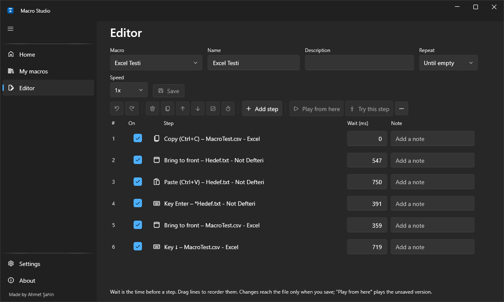
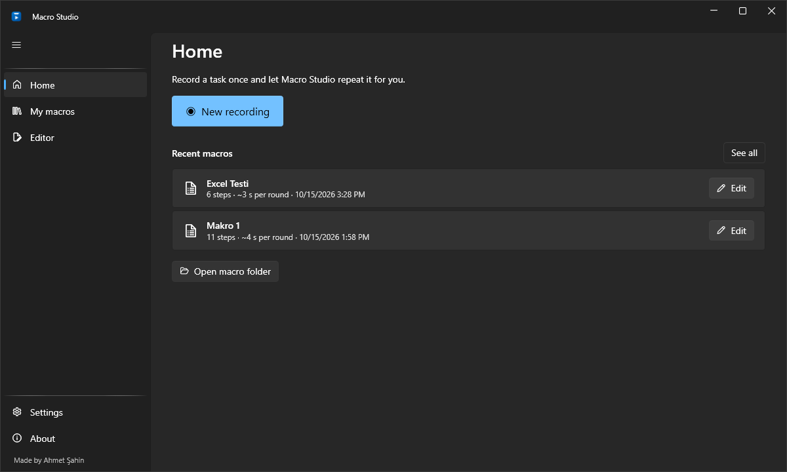
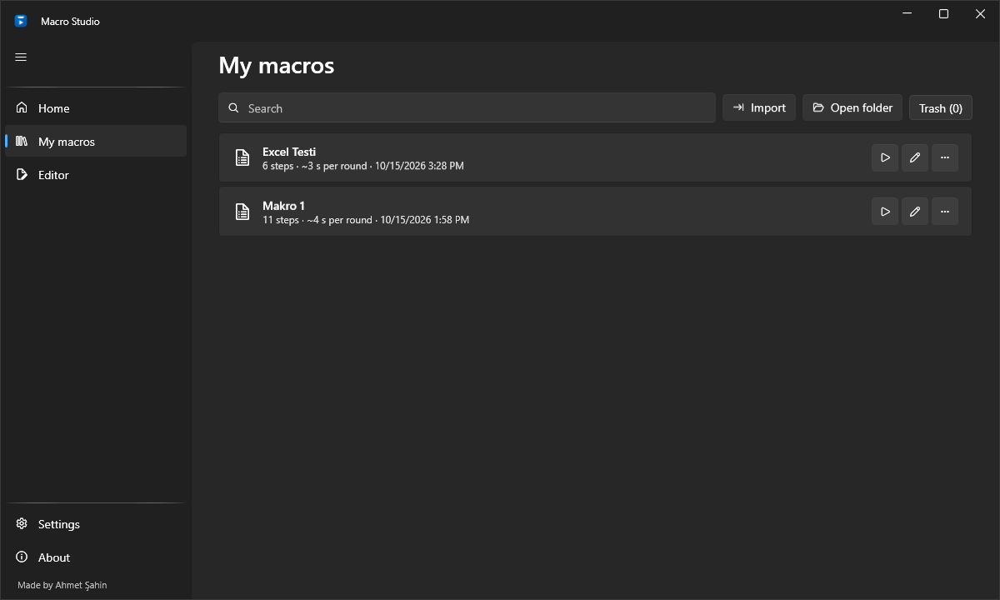

# Macro Studio

[Türkçe](#türkçe) · [English](#english)

<p align="center">
  
</p>

<p align="center">
  
</p>

| | |
|---|---|
|  |  |

---

## Türkçe

Macro Studio, programlar arasında elle yapılan tekrarlayan ofis işini **bir kez kaydedip** istediğiniz kadar tekrar oynatan, Windows 10 ve 11 için ücretsiz ve açık kaynaklı bir makro kaydedici ve oynatıcıdır.

Örnek: Excel'deki bir hücreyi kopyalayıp başka bir programa yapıştırmak, Enter'a basmak, oradan bir değeri kopyalayıp Excel'e geri yazmak ve bir alt satıra geçmek. Bunu bir kez kaydedersiniz; Macro Studio Excel'deki liste bitene kadar tekrarlar.

### Kurulum

1. [Releases](https://github.com/alpha32k/MacroStudio/releases/latest) sayfasından `MacroStudio-<sürüm>-tr-TR.msi` dosyasını indirip açın; İngilizce ekranlar için `en-US` olanı kullanın.
2. Yönetici izni gerekmez. Program yalnızca sizin kullanıcınıza, `%LocalAppData%\Programs\Macro Studio` klasörüne kurulur.
3. Başlat menüsüne kısayol eklenir. Masaüstü kısayolu isteğe bağlıdır; kurulumdaki listeden çıkarabilirsiniz.
4. `.msmacro` dosyaları Macro Studio ile açılır. Çift tıklanan makro, adımları gösterildikten sonra içe aktarılır.

Bilgisayarda .NET kurulu olması gerekmez. Kaldırmak için: Ayarlar > Uygulamalar > Macro Studio > Kaldır. Makrolarınız ve ayarlarınız silinmez.

Kurulum dosyası imzalı değilse Windows SmartScreen "tanınmayan yayımcı" uyarısı gösterir.

### Özellikler

- **Çentik bar:** Ekranın üst ortasında, fareyle üzerine gelince açılan küçük bar. Kaydet, oynat, duraklat, durdur, makro, tekrar ve hız seçimi tek yerde.
- **Akıllı kayıt:**
  - Ctrl+C ve Ctrl+V, panoyu bekleyen kopyala/yapıştır adımlarına dönüşür.
  - Alt+Tab, "şu pencereye geç" adımına dönüşür.
  - Tıklamalar pencereye göre saklanır.
  - Parola alanına yazılanlar kaydedilmez.
- **Güvenli oynatma:**
  - "Kopyalanan değer boşsa dur" ile liste bitince kendiliğinden durur.
  - Fareye veya klavyeye dokunursanız duraklar.
  - Esc veya Ctrl+Alt+End ile anında durur ve basılı tuş bırakmaz.
  - Pencere bulunamazsa, ekran kilitlenirse veya hedef program yönetici olarak çalışıyorsa nedenini söyleyerek durur.
- **Düzenleyici:**
  - Beklemeleri ve notları düzenleme, adım ekleme/silme/sıralama, geri al/yinele.
  - "Buradan oynat" ve "Bu adımı dene".
  - Önceki sürüme dönme.
- **Makrolarım:** arama, çoğaltma, yeniden adlandırma, içe/dışa aktarma (`.msmacro`), 30 günlük çöp kutusu.
- Türkçe ve İngilizce; Windows'a uyan açık ve koyu tema.

### Kısayollar

| Kısayol | İş |
|---|---|
| `Ctrl+Alt+R` | Kaydı başlat / durdur |
| `Ctrl+Alt+P` | Oynat / duraklat / devam |
| `Esc` veya `Ctrl+Alt+End` | Oynatmayı durdur (yalnızca oynatma sırasında) |
| `Ctrl+Alt+M` | Ana pencereyi aç |

### İpuçları

- **Excel'de bir alt satıra fare tekerleğiyle değil ↓ tuşuyla geçin.** Tekerleğin kaydırdığı mesafe her seferinde aynı değildir; uzun bir listede makro sessizce yanlış satırı kopyalar. Kayıtta tekerlek görülürse Macro Studio bunu ↓ tuşuna çevirmeyi önerir.
- Makro çalışırken bilgisayarı kullanmayın. Windows'ta tek bir fare imleci ve tek bir klavye odağı vardır, makro da bunları kullanır.
- Makroyu ilk kez birkaç satırla deneyin, sonra listenin tamamında çalıştırın.

### Verileriniz

Her şey yalnızca sizin bilgisayarınızda, `%LocalAppData%\MacroStudio` altında durur:

| Klasör / dosya | İçerik |
|---|---|
| `macros\` | Makrolar |
| `macros\.history\` | Önceki sürümler |
| `macros\.trash\` | Silinenler |
| `settings.json` | Ayarlar |
| `logs\` | Günlükler |

Macro Studio internete bağlanmaz. Günlüklere yazdığınız tuşlar ve kopyalanan metin yazılmaz.

### Kaynaktan derleme

Gerekenler: Windows 10/11 ve [.NET 10 SDK](https://dotnet.microsoft.com/download).

```text
dotnet build MacroStudio.slnx
dotnet test --solution MacroStudio.slnx
dotnet run --project src/MacroStudio.App
```

Kurulum dosyaları (WiX v5) `installer\out` klasörüne üretilir:

```text
powershell -File installer\build.ps1
powershell -File installer\build.ps1 -CertificateThumbprint <sertifika parmak izi>
```

İkinci komut programı ve kurulum dosyalarını kod imzalama sertifikasıyla imzalar. Bunun için Windows SDK'daki `signtool` gerekir. Her yeni sürümde `Directory.Build.props` içindeki `Version` artırılmalıdır; kurulum eski sürümü ancak böyle değiştirir.

### Belgeler

- [Tasarım belgesi](docs/MacroStudio_Master_Prompt.md): ürünün ne yapması gerektiği, aşama aşama.
- [Kararlar ve test durumu](docs/DECISIONS.md): her kararın nedeni, nelerin denendiği ve nelerin henüz denenmediği.

### Lisans

[MIT](LICENSE). [Ahmet Şahin](https://github.com/alpha32k) tarafından [Claude](https://claude.ai) ile birlikte yapıldı.

---

## English

Macro Studio is a free, open-source macro recorder and player for Windows 10 and 11. It lets you **record once** the repetitive office work you do by hand between programs and play it back as often as you need.

Example: copy a cell in Excel, paste it into another program, press Enter, copy a value from there back into Excel and move one row down. Record it once; Macro Studio repeats it until the Excel list ends.

### Installation

1. Download `MacroStudio-<version>-en-US.msi` from the [Releases](https://github.com/alpha32k/MacroStudio/releases/latest) page and open it; for Turkish screens use the `tr-TR` one.
2. No administrator rights are needed. The program is installed for your user only, in `%LocalAppData%\Programs\Macro Studio`.
3. A Start menu shortcut is added. The desktop shortcut is optional; you can leave it out in the installer's list.
4. `.msmacro` files open with Macro Studio. A double-clicked macro is imported after its steps are shown.

.NET does not need to be installed. To uninstall: Settings > Apps > Macro Studio > Uninstall. Your macros and settings are kept.

When the installer is not signed, Windows SmartScreen warns about an "unknown publisher".

### Features

- **Notch bar:** a small bar at the top center of the screen that opens when you point at it. Record, play, pause, stop, macro, repeat and speed in one place.
- **Smart recording:**
  - Ctrl+C and Ctrl+V become copy and paste steps that wait for the clipboard.
  - Alt+Tab becomes a "switch to this window" step.
  - Clicks are stored relative to their window.
  - Whatever is typed into password fields is not recorded.
- **Safe playback:**
  - "Stop when the copied value is empty" ends the run when the list ends.
  - It pauses when you touch the mouse or keyboard.
  - Esc or Ctrl+Alt+End stop it at once without leaving keys pressed.
  - It stops with a reason when a window is missing, the screen locks or the target program runs as administrator.
- **Editor:**
  - Edit waits and notes, add, delete and reorder steps, undo and redo.
  - "Play from here" and "Try this step".
  - Go back to the previous version.
- **My macros:** search, duplicate, rename, import and export (`.msmacro`), 30-day trash.
- Turkish and English; light and dark themes that follow Windows.

### Shortcuts

| Shortcut | Action |
|---|---|
| `Ctrl+Alt+R` | Start / stop recording |
| `Ctrl+Alt+P` | Play / pause / resume |
| `Esc` or `Ctrl+Alt+End` | Stop playback (only while playing) |
| `Ctrl+Alt+M` | Open the main window |

### Tips

- **In Excel, move to the next row with ↓, not the mouse wheel.** A wheel notch does not scroll the same distance every time; over a long list the macro silently copies the wrong row. When a recording uses the wheel, Macro Studio offers to turn it into ↓.
- Do not use the computer while a macro plays. Windows has one pointer and one keyboard focus, and the macro uses them.
- Try a new macro on a few rows first, then run it on the whole list.

### Your data

Everything stays on your computer, under `%LocalAppData%\MacroStudio`:

| Folder / file | Contents |
|---|---|
| `macros\` | Macros |
| `macros\.history\` | Earlier versions |
| `macros\.trash\` | Deleted macros |
| `settings.json` | Settings |
| `logs\` | Logs |

Macro Studio never connects to the internet. Logs never contain the keys you type or the text you copy.

### Building from source

Requirements: Windows 10/11 and the [.NET 10 SDK](https://dotnet.microsoft.com/download).

```text
dotnet build MacroStudio.slnx
dotnet test --solution MacroStudio.slnx
dotnet run --project src/MacroStudio.App
```

The installers (WiX v5) are built into `installer\out`:

```text
powershell -File installer\build.ps1
powershell -File installer\build.ps1 -CertificateThumbprint <certificate thumbprint>
```

The second command signs the program and the installers with a code-signing certificate; it needs `signtool` from the Windows SDK. Raise `Version` in `Directory.Build.props` for every new release; only then does the installer replace the old version.

### Documents

- [Design document](docs/MacroStudio_Master_Prompt.md) (Turkish): what the product must do, stage by stage.
- [Decisions and test status](docs/DECISIONS.md) (Turkish): the reason for each decision, what was tested and what not yet.

### License

[MIT](LICENSE). Made by [Ahmet Şahin](https://github.com/alpha32k) together with [Claude](https://claude.ai).
